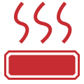

# KNOMI Screen Preservation Guide

Status: source-derived reference and owner-approved adaptation direction, 2026-11-10. This is a guide for the later hand-written LVGL UI, not implemented screens or verified full-screen screenshots.

## 1. Scope and Evidence

The missing SquareLine project prevents editing/regenerating that project, but the generated C still describes object sizes, anchors, offsets, fonts, assets and styles. Runtime overlay code supplies values, priorities and recoloring. Preserve that visual evidence before Phase 1 removes the generated UI; do not retain its printer-control callbacks or touch dependencies.

Owner decisions:

- Cover all adaptable read-only screens: heating, temperatures, progress, GIF/status, network/setup and information.
- Closely preserve recognizable original geometry, icon scale, rings, large numerals and typography. Additional Creality data belongs on rotating pages, not an overcrowded progress screen.
- Replace the printing screen's X/Y/Z accelerometer area with remaining and elapsed time.
- Use green for decorative/theme/progress accents. **Keep the original heater-fill graphics red.** Do not add temperature-threshold or cooldown-warning behavior; it was not selected.
- Keep the existing read-only protocol/state rules. A visual reference does not restore Moonraker controls, touch, sensors, v2 features or old state derivation.

Sources below are relative to the repository. Generated headers identify SquareLine Studio 1.3.1 / LVGL 8.3.6; the target is LVGL 8.4.0 with the Phase 0.5 4-bpp fonts. Current generated font files have already been regenerated in place, so this is not a claim of bit-identical original firmware rendering.

## 2. Visual and Color Contract

| Role | Original Evidence | Hand-Written Target |
|---|---|---|
| Canvas | 240 x 240; mostly black | Keep black, round-display composition |
| Primary numerals | Inter SemiBold; 24 px heater values, 48 px progress | Keep sizes/hierarchy using the regenerated 4-bpp fonts |
| Actual temperature / progress text | `#FFD164` in the generated heating, temperature and printing screens | Retain warm-yellow numeric emphasis; not part of blanket red-to-green conversion |
| Theme/decorative red | `#C02F30` progress/decorative arcs; red network spinner | Replace decorative/progress accent with KNOMI green `#329A40` |
| Thermal fill | Gray base image plus red nozzle/bed image in the indicator part | **Retain original gray/red assets and their native red pixels**; no green recoloring |
| Semantic states | New Creality plan | Paused amber `#F0A020`, error red `#E53935`, completed light green `#5DA910`, secondary/stopped gray `#808080` |

The old theme helper in [src/ui_overlay/lv_theme_color.cpp](../src/ui_overlay/lv_theme_color.cpp) recolors the heating indicator images together with unrelated theme objects. **Do not reproduce that grouping.** Use role-specific styling: heater fills are excluded from theme recoloring, while printing/decorative arcs can be green. Error red and thermal red have different meanings; neither is a theme accent.

Heating fill is a visualization of `actual / target`, not an independent indication that a surface is safe or dangerous. Keep it red even when the target has just been reached. No new red threshold, hysteresis, cooldown screen or target-zero hot warning is specified. Existing first-target-reach logic determines when a heating phase ends; it does not recolor the asset.

## 3. Nozzle and Bed Heating

Sources: [src/ui/screens/ui_ScreenHeatingNozzle.c](../src/ui/screens/ui_ScreenHeatingNozzle.c), [src/ui/screens/ui_ScreenHeatingBed.c](../src/ui/screens/ui_ScreenHeatingBed.c), and [src/ui_overlay/lv_moonraker_change_screen.cpp](../src/ui_overlay/lv_moonraker_change_screen.cpp).

| Element | Nozzle | Bed |
|---|---|---|
| Background | Black | Black |
| Central icon/fill object | 122 x 125, `LV_ALIGN_CENTER` | 120 x 121, `LV_ALIGN_CENTER` |
| Main/background image | `ui_img_nozzle_gray_png` | `ui_img_bed_gray_png` |
| Indicator image | `ui_img_nozzle_red_png` | `ui_img_bed_red_png` |
| Actual value | `LV_ALIGN_TOP_MID`, x=0, y=20; Inter SemiBold 24, `#FFD164` | Same |
| Target value | `LV_ALIGN_BOTTOM_MID`, x=0, y=-20; Inter SemiBold 24 | Same |
| Knob / normal slider fill | Transparent | Transparent |
| Interaction | Non-clickable image-backed indicator | Non-clickable image-backed indicator |

Original assets, **not full-screen screenshots**:

| Nozzle Gray | Nozzle Red | Bed Gray | Bed Red |
|---|---|---|---|
|  |  |  |  |

The runtime sets the selected indicator to integer `actual * 100 / target` with animation, only when target is nonzero and the corresponding screen is active. The generated screens do not explicitly set slider range/orientation, so do not claim a proven fill direction from these statements alone; verify actual LVGL rendering. The hand-written implementation must clamp the displayed ratio to 0..100, avoid division by zero, and distinguish unknown values from zero. It need not use the slider widget if an image mask reproduces the same appearance.

Retain the large icon with separate top actual and bottom target values. This replaces the draft's generic two-bar treatment when nozzle/bed heating is the primary operation. Keep the approved nozzle-first selection, exact first-target-reach completion and re-arm rules from [docs/CREALITY_WS_PROTOCOL.md](CREALITY_WS_PROTOCOL.md#54-knomi-derivation-rules-first-match-wins); do not copy the old +/-2-degree/overshoot state logic. During self-test, calibration and resuming, keep the operation identifiable and expose the selected heater without losing step/operation information. The exact combined composition must be reviewed in the future LVGL preview before implementation is accepted.

The bed source has a stray nozzle image assigned to the root scrollbar part. It is not the bed indicator and is not a design requirement; do not reproduce it.

## 4. Print Progress and Timing

Source: [src/ui/screens/ui_ScreenPrinting.c](../src/ui/screens/ui_ScreenPrinting.c). Keep the original display identity without the unavailable accelerometer UI.

| Element | Original Geometry / Style | Adaptation |
|---|---|---|
| Progress text | Generated v2: top-middle, x=0, y=50; Inter SemiBold 48; `#FFD164`. Runtime without accelerometer: center, y=0 | Keep large percentage/emphasis; use the v1 centered presentation as the baseline, fitting timing beneath it |
| Progress arc | 212 x 212, centered; rotation 270; background angles 0..360; 20 px indicator | Keep scale, start angle and thickness; indicator green |
| Outer decorative circle | 240 x 240, centered; 2 px visible indicator | Keep circular framing; green |
| Segmented decorative ring | 230 x 230; segments 272..42, 47..134, 138..268 degrees; 4 px, square ends | Keep segment language; green |
| X/Y/Z widgets | 18 x 58 bars near y=115; labels near y=175 | Remove sensor bars and X/Y/Z labels; reserve this lower central area for remaining and elapsed time |

[src/lvgl_usr.cpp](../src/lvgl_usr.cpp) changes the generated layout under `#ifndef LIS2DW_SUPPORT`: the percentage is centered at y=0 and all X/Y/Z objects are deleted. This is the v1 runtime reference; the generated y=50 layout alone must not be presented as the original sensor-free screen.

Proposed new timing content: compact labeled `Left` and `Elapsed` values below the percentage, using the target 14/18 px fonts as space permits. Preserve the percentage/rings first; do not force three data columns into the old bar positions. Confirm exact time-row positions from font metrics and the round mask, rather than treating proposed positions as measured legacy geometry. Use planned time formatting and unknown-value placeholders; do not show zero remaining time as a proven completion signal.

Keep the approved auto-rotating progress/timing, temperature and layer/file pages. New chamber, filename, layer and optional fan/speed values go on those extra pages, not inside the progress ring at the expense of the original layout. Paused keeps the same composition with amber status styling. A nonzero valid error overrides the job view with the Error screen; it must not be reduced to a badge. GIF interstitials remain governed by the plan and the one-decoder rule.

## 5. Temperature Summary

Source: [src/ui/screens/ui_ScreenTemp.c](../src/ui/screens/ui_ScreenTemp.c).

- Original nozzle panel: 86 x 97, top-left x=25/y=57. Bed panel: 86 x 97, top-right x=-25/y=57. Each has a centered icon, actual at top-middle y=10 in warm yellow and target at bottom-middle y=-15, both 14 px.
- Preserve the recognizable paired nozzle/bed presentation and actual-over-target hierarchy as read-only groups. Replace `lv_imgbtn` with non-clickable containers/images; retain no temperature-setting events or button affordance.
- The original `Preheat` button is 108 x 38, bottom-middle y=-25. **Remove it.** Its freed space is a candidate for the required chamber value, with its placement verified in the target render.
- `ui_img_sta_temp_png` and `ui_img_bg_png` are original framing/background references, not thermal warning indicators. They may be replaced by close LVGL-drawn equivalents if screenshots confirm the match. Do not retain a control-shaped preheat button as decoration.
- Do not substitute the generic planned three-row temperature layout without review: use the original paired composition as the starting point and fit chamber data without crowding.

## 6. Other Adaptable Screens

| Original Source | Measured Reference | Target / Deliberate Differences |
|---|---|---|
| [src/ui/screens/ui_ScreenMainGif.c](../src/ui/screens/ui_ScreenMainGif.c) | Black, non-scrolling root; runtime centers the main GIF | S5 idle and processing/self-test/completed GIF presentations. Keep centered composition and approved green GIFs/Creality logo; remove old touch events and share one GIF object |
| [src/ui/screens/ui_ScreenWelcome.c](../src/ui/screens/ui_ScreenWelcome.c) | White root; blue `#4082F4` connection text, bottom-middle y=-40; runtime puts welcome GIF at center y=-36 | S1 setup: recognizable centered Wi-Fi animation with compact SSID/URL text and alternate QR page. Use planned black/green theme; do not copy old paragraph wrapping or real credentials |
| [src/ui/screens/ui_ScreenWIFIConnecting.c](../src/ui/screens/ui_ScreenWIFIConnecting.c) | 240 x 240 edge spinner, 16 px indicator, 1000 ms period / 45-degree arc; centered BTT logo | S2/S4b connecting: preserve ring scale/motion, use green for normal connection activity and semantic warning color when required. Replace BTT branding with relevant connection information; do not keep that logo asset |
| [src/ui/screens/ui_ScreenWIFIDisconnect.c](../src/ui/screens/ui_ScreenWIFIDisconnect.c) | White root; centered disconnect image y=-17; blue explanatory text bottom-middle y=-30 | S3 lost: keep icon-over-status composition; adapt to black background, concise status and automatic retry information. Do not retain the old instruction to restart as recovery logic |
| [src/ui/screens/ui_ScreenQRCode.c](../src/ui/screens/ui_ScreenQRCode.c) | Black root; bottom-middle caption x=-3/y=-30, original 16 px font | Runtime adds centered 130 x 130 QR with white modules on black. Reuse geometry for Wi-Fi join/device-URL pages, not the old BTT manual URL; verify quiet zone and phone scanning before choosing final polarity/size |
| [src/ui/screens/ui_ScreenInfo.c](../src/ui/screens/ui_ScreenInfo.c) | Four framed rows centered at y=-58/-19/20/59; endcaps x=-91/+91; yellow key/white value hierarchy; value areas 110 x 20 with circular scrolling | S12 Info: preserve compact rows/alignment, paginate extra device/printer fields instead of shrinking everything into four rows. Use 14/18 px target fonts in place of unsupported legacy 16 px; native-drawn frames may replace bitmap caps after comparison |
| [src/ui/screens/ui_ScreenPopup.c](../src/ui/screens/ui_ScreenPopup.c) | 175 x 130 frame, center y=-15; 135 x 90 content area, parent-centered y=-5; 14 px text | Read-only notification reference. Replace textarea with a wrapped label, drop touch OK button, and use GPIO0 only where a local action is allowed. Long error code/model content needs a separately checked S11 layout; do not blindly constrain it to the old popup |
| [src/ui/screens/ui_ScreenDialog.c](../src/ui/screens/ui_ScreenDialog.c) | Black canvas; 24 px prompt top-middle y=74; touch confirm/cancel controls below | Typography/spacing reference only for permitted local setup/reset prompts. Do not carry over Start Printing, printer commands or on-screen touch controls. Local error acknowledgement never suppresses a nonzero ERROR |

Runtime sources: [src/lvgl_usr.cpp](../src/lvgl_usr.cpp) creates the welcome/main GIFs and QR; [src/ui_overlay/lv_wifi_change_screen.cpp](../src/ui_overlay/lv_wifi_change_screen.cpp) selects the old network screens; [src/ui_overlay/lv_theme_color.cpp](../src/ui_overlay/lv_theme_color.cpp) defines recoloring. Their appearance can inform the new implementation, but their duplicate GIFs and Moonraker/touch-specific wiring must not be copied.

Welcome/disconnect black-background adaptations are intentional differences from their original white/blue screens. Original 16/20/32 px fonts are not silently restored; the selected 14/18/24/48 px family remains the target and any affected text box requires a render check.

### Screen Disposition

Together with sections 3-5, the table covers all 12 visually adaptable sources. The other nine generated screens are not target experiences: Backlight (hard-wired backlight), ColorWheel (fixed theme), Extrude/SetExtrude/Move/SetTemp/Roller (controls or touch editing), TestImg and TestSensor (old diagnostics/v2 sensors). They may be inspected as historical assets but are not reasons to preserve their callbacks/widgets/dependencies.

S0 splash, S4a printer setup, chamber/file/layer detail, state-specific stopped/completed/error content and input-shaping text are Creality adaptations, not alleged original KNOMI screens. Compose them using the documented typography, centered graphics, ring framing and compact information hierarchy. Existing green GIFs supply homing/self-test/result imagery; no unrelated old controls are reintroduced to fill a new state's screen.

## 7. Asset Retention and Budget

Measured from the original C arrays/descriptors on 2026-11-10; byte counts are RGB565 plus per-pixel alpha, not C source-file sizes or runtime framebuffer allocations.

| Symbol | Native Image Dimensions | Payload Bytes | Disposition |
|---|---|---|---|
| `ui_img_nozzle_png` | 24 x 30 | 2,160 | Retain small icon |
| `ui_img_bed_png` | 29 x 29 | 2,523 | Retain small icon |
| `ui_img_nozzle_gray_png` | 122 x 111 | 40,626 | Retain gray heater base |
| `ui_img_nozzle_red_png` | 122 x 111 | 40,626 | Retain original red fill |
| `ui_img_bed_gray_png` | 120 x 120 | 43,200 | Retain gray heater base |
| `ui_img_bed_red_png` | 120 x 120 | 43,200 | Retain original red fill |
| **Six mandatory icons/images** | | **172,335** | **167,652** bytes are the four large heater images |
| `ui_img_bg_png` | 240 x 240 | 172,800 | Reference; decide on a close native-drawn equivalent before copying a large decorative bitmap |
| `ui_img_sta_temp_png` | 86 x 97 | 25,026 | Temperature-panel frame reference |
| `ui_img_roller_rec_left_png` / `mid` / `right` | 11 x 38 / 172 x 38 / 11 x 38 | 1,254 / 19,608 / 1,254 | Info-row frame reference |
| `ui_img_wifi_disconnect_png` | 58 x 56 | 9,744 | Network-icon reference; retain or replace after visual review |
| `ui_img_popup_png` | 175 x 130 | 68,250 | Notification-frame reference; avoid shipping an unnecessary bitmap if primitives match |

The nozzle image's 122 x 111 dimensions differ from its 122 x 125 indicator object; the bed image is 120 x 120 inside a 120 x 121 object. Preserve both facts; do not resize the assets merely to make those numbers equal. All six mandatory assets are `LV_IMG_CF_TRUE_COLOR_ALPHA`. Four large images use `sizeof(array)` in the descriptor; their measured byte-array lengths match dimensions/format.

Keep small icons under the target `ui/assets/icons/` and large heater art under `ui/assets/images/`; the small-icon 32/40 px guidance does **not** apply to large reference heater artwork. The 470 KiB Phase 0.5 gate remains a GIF-only budget. GIF payload 458,197 plus these six image payloads 172,335 is **630,532 bytes**, excluding font tables, descriptors, code and other assets. Recheck full-firmware flash after integration; no new linked image size or live memory result is claimed here. Do not introduce a full-frame draw buffer to display these flash-resident images.

## 8. Preservation and Review Gates

Pre-cleanup requirements are steps 1-4. Target comparison/acceptance follows in Phase 5 (step 5); the new UI is not a prerequisite for starting cleanup.

1. Retain the source-derived measurements and screen-to-target mapping in this guide. Keep the exported reference PNG/GIF assets under `docs/screens/`.
2. Carry forward the six mandatory nozzle/bed assets in section 7 before deleting `src/ui/images/`; never run a blanket red-to-green conversion on those heater graphics. The remaining assets are references, with retain/redraw decisions verified before deletion.
3. Before deleting the source, render the selected legacy screens through LVGL off-screen or a simulator with injected values, or obtain device photos. The current [tools/render_ui_screens.py](../tools/render_ui_screens.py) exports individual assets only; it is **not** a screen renderer. Mark source-only references, simulated captures and device photos distinctly.
4. Save representative **original** references: heater 0/25/50/100 percent, zero target and overshoot; print 0/57/100 percent; temperature panels; network/QR/info/notification screens. Record unsupported original cases rather than fabricating legacy behavior. In Phase 5 capture the corresponding target cases plus the new unknown-value handling, paused styling, timing, chamber and error content. Do not expose real Wi-Fi credentials in reference images.
5. **Phase 5:** compare original/target geometry, text bounds, ring widths, native heater red, green decorative accents, typography and round-display clipping. Native LVGL rendering is authoritative for layout/defaults; the physical S3 display remains authoritative for orientation/color/legibility. New content is an adaptation, not a purported original screenshot.
6. Preserve appearance, not defects: discard controls, touch navigation, accelerometer content, stray style assignments and invalid-zero assumptions. Do not restore the old cross-task LVGL calls, duplicate GIF objects or full-frame PSRAM draw buffer.

Phase 1 may delete the generated runtime only after the preservation gate is met. This task does not perform that deletion, generate whole-screen renders, modify reference captures/baselines, or implement the new UI. Physical screen acceptance remains Phase 5/HIL work.